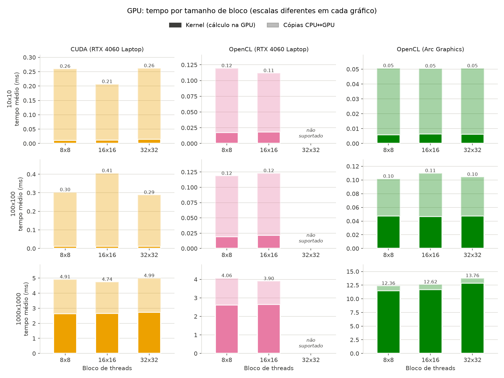
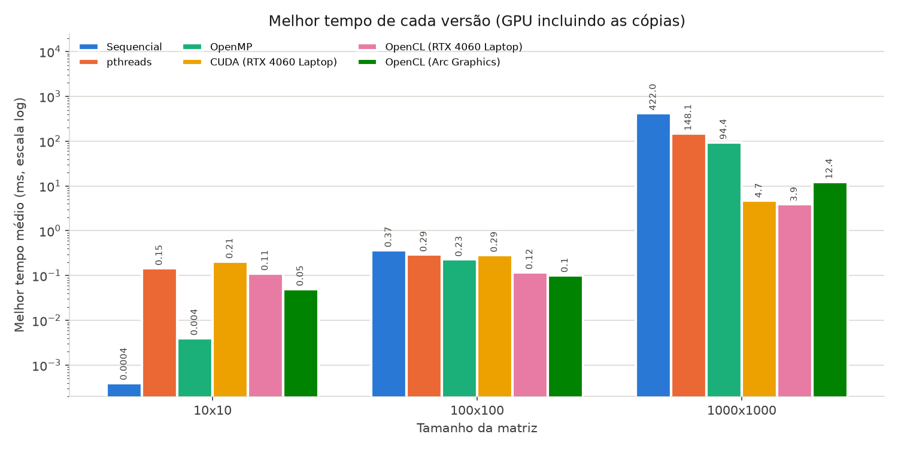

# Parte 3: análise das versões em GPU (CUDA e OpenCL) e comparação geral

## Por que duas versões de GPU

| Versão | Fonte | Roda em |
| --- | --- | --- |
| CUDA | [`cuda.cu`](../cuda.cu) | só GPUs **NVIDIA** |
| OpenCL | [`opencl.c`](../opencl.c) | GPUs **AMD, NVIDIA e Intel** (inclusive as integradas ao processador) |

CUDA é a tecnologia mais usada para programar GPUs, mas é exclusiva da NVIDIA. Para que qualquer pessoa possa medir a própria GPU, há também uma versão em OpenCL, um padrão aberto suportado pelos drivers dos três fabricantes. As duas usam **o mesmo kernel**: cada thread da GPU calcula um elemento do produto, com o mesmo laço das versões de CPU.

## Ambiente de teste

- Mesma máquina da [análise do OpenMP](ANALISE_OPENMP.md): notebook com CPU Intel Core Ultra 7 155H (22 núcleos lógicos)
- Duas GPUs:
  - **NVIDIA GeForce RTX 4060 Laptop**: placa dedicada, 8 GB de memória própria, 3072 núcleos CUDA;
  - **Intel Arc Graphics**: GPU integrada ao processador, que usa a mesma memória principal da CPU.
- CUDA: Toolkit 13.0, `nvcc -O2 -arch=native`, rodando no **WSL2** (como as versões de CPU)
- OpenCL: compilado com o MSVC 2022 (`cl /O2`), rodando direto no **Windows**, porque no WSL2 não há driver OpenCL para essas GPUs
- Matrizes de 10×10, 100×100 e 1000×1000; blocos de 8×8, 16×16 e 32×32 threads
- **10 repetições** por caso; os tempos abaixo são a média
- Dados brutos: [`cuda.csv`](cuda.csv) e [`opencl.csv`](opencl.csv). Resumos: [`gpu_resumo.csv`](gpu_resumo.csv) e [`comparacao.csv`](comparacao.csv)

A soma de verificação das GPUs foi igual à das versões de CPU em todas as 240 execuções (90 em CUDA e 150 em OpenCL).

## Como as versões de GPU funcionam e o que é medido

A GPU dedicada tem memória própria, então o programa faz três etapas:

1. copia `m1` e `m2` para a GPU;
2. executa o *kernel* (a multiplicação);
3. copia `prod` de volta.

São medidos dois tempos, pelos contadores da própria GPU (`cudaEvent` no CUDA e *profiling events* no OpenCL):

- **com cópias** (etapas 1 a 3): é o que se compara de forma justa com a CPU, que já tem os dados na memória;
- **só kernel** (etapa 2): mostra a capacidade de cálculo da GPU.

Como nas versões de CPU, ficam fora da medição a alocação de memória, a inicialização e a preparação da GPU (criar o contexto e compilar e carregar o kernel), além de uma execução de aquecimento. O custo dessa preparação é discutido mais adiante.

## Efeito do tamanho do bloco

*Parte cheia: kernel. Parte clara: cópias. Cada gráfico tem sua própria escala.*

| Configuração | Bloco | 1000×1000 com cópias | Só kernel | Cópias |
| --- | --- | --- | --- | --- |
| CUDA (RTX 4060) | 8×8 | 4,91 ms | 2,65 ms | 2,26 ms |
| CUDA (RTX 4060) | 16×16 | **4,74 ms** | 2,67 ms | 2,08 ms |
| CUDA (RTX 4060) | 32×32 | 4,99 ms | 2,73 ms | 2,26 ms |
| OpenCL (RTX 4060) | 8×8 | 4,06 ms | 2,62 ms | 1,44 ms |
| OpenCL (RTX 4060) | 16×16 | **3,90 ms** | 2,64 ms | 1,26 ms |
| OpenCL (RTX 4060) | 32×32 | não suportado | – | – |
| OpenCL (Arc) | 8×8 | **12,36 ms** | 11,47 ms | 0,89 ms |
| OpenCL (Arc) | 16×16 | 12,62 ms | 11,71 ms | 0,91 ms |
| OpenCL (Arc) | 32×32 | 13,76 ms | 12,90 ms | 0,87 ms |

- **Na RTX 4060, o tamanho do bloco quase não importa:** o kernel varia menos de 4% entre os tamanhos. Na Arc, blocos menores são um pouco melhores (11,5 ms com 8×8 contra 12,9 ms com 32×32).
- **Blocos de 32×32 (1024 threads) não são aceitos em todas as GPUs.** O driver OpenCL da NVIDIA permite no máximo 256 threads por bloco para este kernel. Muitas GPUs AMD têm esse mesmo limite. O programa consulta o limite e avisa quando o bloco não é possível. Por isso, 16×16 é o tamanho mais seguro para quem for testar em outra GPU.

## CUDA x OpenCL na mesma GPU

Na RTX 4060, **o kernel leva o mesmo tempo nas duas versões** (2,65 ms no CUDA e 2,62 ms no OpenCL). Faz sentido: o código do kernel é o mesmo e o driver gera instruções praticamente iguais. A diferença está nas cópias, mais lentas no CUDA (2,1 ms contra 1,3 ms no 1000×1000; ~0,2–0,4 ms contra ~0,1 ms nas matrizes pequenas). Isso vem do ambiente, não da tecnologia: no WSL2, cada cópia passa por uma camada de virtualização até chegar ao driver do Windows, enquanto o OpenCL rodou direto no Windows.

Conclusão: para este problema, **escolher OpenCL em vez de CUDA não custa desempenho**, e o programa passa a rodar em qualquer GPU.

## GPU dedicada x GPU integrada

| | RTX 4060 (dedicada) | Arc (integrada) |
| --- | --- | --- |
| Kernel 1000×1000 | 2,6 ms | 11,5 ms (4,4× mais lento) |
| Cópias 1000×1000 | 1,3 ms | 0,9 ms |
| Custo fixo das cópias (10×10) | ~0,1 ms | ~0,04 ms |

- A placa dedicada calcula muito mais rápido, porque tem mais núcleos e uma memória própria muito mais rápida (~256 GB/s).
- A GPU integrada tem cópias mais baratas, porque usa a mesma memória da CPU: copiar é só mover dados dentro da memória principal, sem passar pelo barramento PCIe.
- Mesmo a GPU integrada é **7,6× mais rápida que o melhor OpenMP** no 1000×1000 (12,4 ms contra 94 ms).

## Comparação geral: melhor tempo de cada versão

Para cada versão, a melhor configuração encontrada. Nas GPUs, o tempo inclui as cópias.

| Matriz | Sequencial | pthreads | OpenMP | CUDA (RTX) | OpenCL (RTX) | OpenCL (Arc) |
| --- | --- | --- | --- | --- | --- | --- |
| 10×10 | **< 0,001 ms** | 0,146 ms | 0,004 ms | 0,207 ms | 0,112 ms | 0,050 ms |
| 100×100 | 0,371 ms | 0,294 ms | 0,230 ms | 0,288 ms | 0,119 ms | **0,102 ms** |
| 1000×1000 | 422 ms | 148 ms | 94 ms | 4,74 ms | **3,90 ms** | 12,36 ms |

Speedup em relação à versão sequencial:

| Matriz | pthreads | OpenMP | CUDA (RTX) | OpenCL (RTX) | OpenCL (Arc) |
| --- | --- | --- | --- | --- | --- |
| 10×10 | 0,003× | 0,10× | 0,002× | 0,004× | 0,008× |
| 100×100 | 1,26× | 1,61× | 1,29× | 3,13× | **3,65×** |
| 1000×1000 | 2,85× | 4,47× | 89× | **108×** | 34× |

- **10×10:** a versão sequencial vence todas. A multiplicação leva menos de 1 µs, abaixo da resolução do `gettimeofday`. Qualquer paralelismo custa mais que o cálculo.
- **100×100:** as GPUs rodando no Windows já vencem a CPU. A integrada é a mais rápida, porque suas cópias são as mais baratas. O CUDA no WSL2 fica no nível do OpenMP, por causa das cópias mais lentas.
- **1000×1000:** a RTX 4060 é **~100× mais rápida que a sequencial** e ~24× mais rápida que o melhor OpenMP, mesmo contando as cópias.

## Por que a GPU é tão mais rápida no 1000×1000

- **Muito mais unidades de cálculo:** são 3072 núcleos na RTX 4060 contra 22 núcleos lógicos na CPU. A multiplicação 1000×1000 tem 1 milhão de elementos independentes, trabalho suficiente para ocupar todos eles.
- **O gargalo de memória da CPU some.** Na CPU, ler `m2[x*tam+j]` coluna por coluna causa falhas de cache, e isso limitou o OpenMP a ~4,5×. Na GPU, threads vizinhas têm `col` consecutivos e leem posições vizinhas de `m2` ao mesmo tempo, numa única transação (acesso *coalescido*). Já `m1[lin*tam+x]` é o mesmo endereço para o grupo inteiro, lido uma vez e distribuído. O mesmo código que sofre na CPU é eficiente na GPU.

## O custo que não aparece na medição: preparar a GPU

A medição cobre só a multiplicação, mas usar a GPU tem um custo de partida bem maior que criar threads na CPU. Esse custo inclui criar o contexto e carregar o kernel; no OpenCL, inclui ainda compilar o kernel e iniciar o driver de cada fabricante para listar as GPUs. Tempo do **programa inteiro** com a matriz 1000×1000:

| Programa | Programa inteiro | Multiplicação medida |
| --- | --- | --- |
| `sequencial 1000` | ~460 ms | 422 ms |
| `openmp 1000 16` | **~108 ms** | 94 ms |
| `cuda 1000 32` (RTX, WSL2) | ~175 ms (753 ms na 1ª execução) | 4,7 ms |
| `opencl 1000 16 0` (RTX, Windows) | ~290–410 ms (2 s na 1ª execução) | 3,9 ms |
| `opencl 1000 16 1` (Arc, Windows) | ~330–470 ms | 12,4 ms |

Para **uma única** multiplicação 1000×1000, os programas de GPU são **mais lentos que o OpenMP** do início ao fim, porque gastam centenas de milissegundos só preparando a GPU. A primeira execução depois de um tempo parada é ainda mais lenta, provavelmente porque o driver precisa tirar a GPU do modo de economia de energia. A GPU compensa quando esse custo fixo é dividido entre muito trabalho: matrizes maiores ou muitas multiplicações no mesmo programa.

## Conclusões

1. Para matrizes grandes, as GPUs são muito mais rápidas que a CPU: 3,9 ms na RTX 4060 contra 94 ms do melhor OpenMP e 422 ms da sequencial, mesmo contando as cópias. Até a GPU integrada é 7,6× mais rápida que o OpenMP.
2. Para matrizes pequenas, o custo de usar a GPU (cópias de ~0,05 a 0,3 ms) é maior que o cálculo. Em 10×10, nenhuma versão paralela vence a sequencial.
3. CUDA e OpenCL têm o mesmo desempenho de kernel na mesma GPU. O OpenCL tem a vantagem de rodar em GPUs AMD, NVIDIA e Intel.
4. As cópias entre CPU e GPU precisam entrar na comparação. Elas são de 7% (Arc, 1000×1000) a mais de 90% (matrizes pequenas) do tempo medido, dependendo da GPU e do tamanho, e são mais baratas na GPU integrada, que compartilha a memória com a CPU.
5. O tamanho do bloco pouco muda o desempenho, mas 32×32 não é aceito em todas as GPUs; 16×16 é a escolha mais portável.
6. Considerando o programa inteiro, preparar a GPU custa centenas de milissegundos, e por isso uma única multiplicação 1000×1000 termina antes com o OpenMP. A GPU vale a pena quando há trabalho suficiente para amortizar esse custo.
7. CPU e GPU usam modelos de paralelismo diferentes. Na CPU, poucas threads pesadas recebem cada uma um bloco de linhas. Na GPU, milhões de threads leves calculam cada uma um elemento, e o padrão de acesso que limita a CPU (ler `m2` por colunas) passa a ser eficiente.

## Como medir na sua GPU

- **GPU NVIDIA:** dá para usar as duas versões, `scripts/benchmark_cuda.sh` e `scripts/benchmark_opencl.sh`.
- **GPU AMD ou Intel:** só a versão OpenCL, `scripts/benchmark_opencl.sh`. Ele mede todas as GPUs encontradas.

Depois, rode `python3 scripts/graficos_gpu.py`. Ele usa os resultados que existirem (CUDA, OpenCL ou os dois). Instruções de instalação no [README](../README.md).

## Possíveis melhorias

- **Memória local/compartilhada (*tiling*):** cada bloco carrega pedaços de `m1` e `m2` numa memória rápida do próprio multiprocessador e os reutiliza, reduzindo os acessos à memória principal da GPU. É a otimização clássica deste problema.
- **Memória fixada (*pinned*):** com `cudaMallocHost` no CUDA ou `CL_MEM_ALLOC_HOST_PTR` no OpenCL, as cópias ficam mais rápidas que com a memória comum alocada por `malloc`.
- **Matrizes maiores** (2000×2000 ou mais) mostrariam o custo de preparação da GPU ficando desprezível e a vantagem da GPU crescendo.
